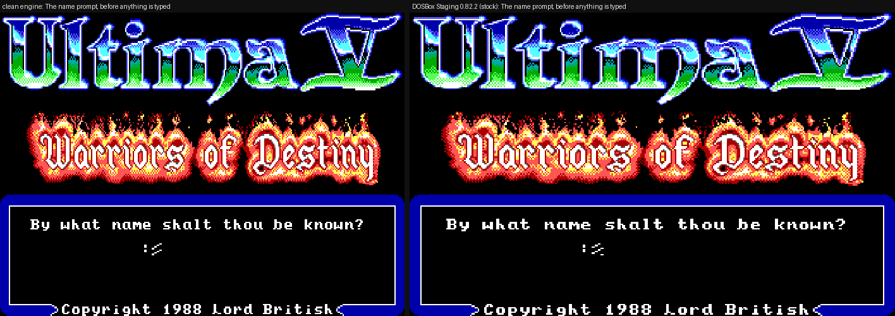
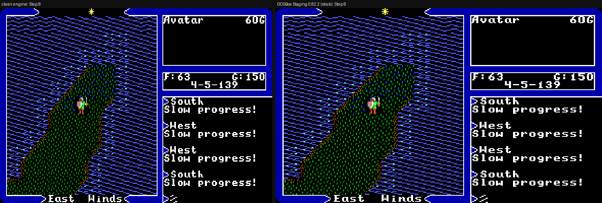
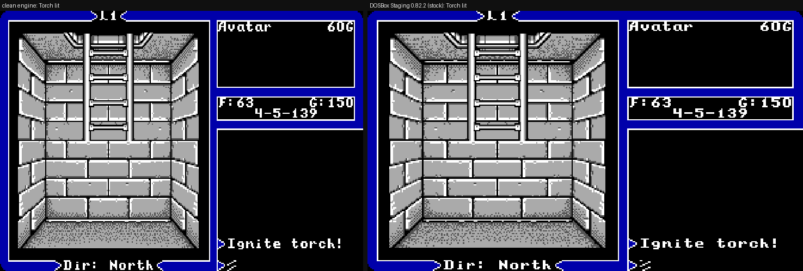
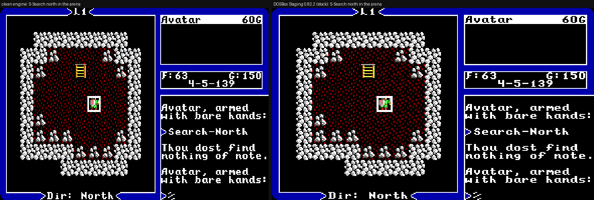
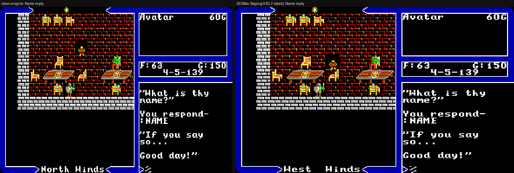
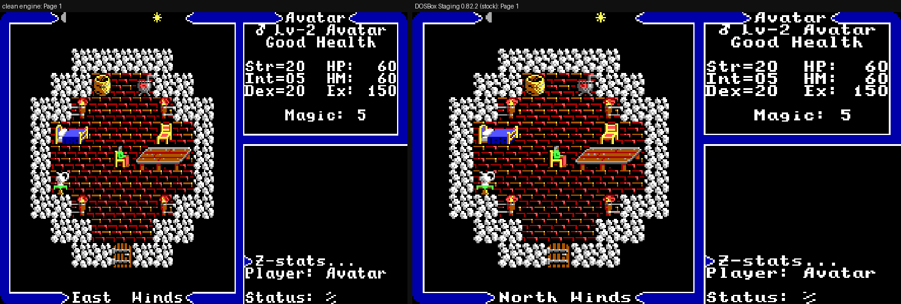

# u5-engine

A clean-room recreation of **Ultima V: Warriors of Destiny** (Origin, 1988) in
Rust, built only from the public specification in
[cleak/u5-spec](https://github.com/cleak/u5-spec). It plays the game from your
own copy of the original data files and is checked frame by frame against the
original DOS game running in DOSBox.

No original game data is included. You need your own copy of Ultima V; the GOG
release works.

## Side by side

Each image is one moment captured from both programs given the same save and
the same keystrokes: **the engine on the left, the original game in DOSBox on
the right.** They come from the paired test suite described [below](#how-its-verified).

| | |
|---|---|
|  |  |
| Character creation | Overworld travel |
|  |  |
| First-person dungeon | Combat |
|  |  |
| Conversation | Character stats |

Some things legitimately differ from run to run, because the original seeds its
random number generator from the clock: the wind direction, where wandering
NPCs stand, dice rolls and greeting choices. The comparison tooling knows which
differences are random and which are real.

## Status

The game is playable from character creation to the endgame. Implemented
systems:

- the overworld, towns, castles and dungeons;
- combat;
- magic and reagent mixing;
- conversations, shops, inns, healers and guilds;
- quests: the shrines and Codex, the shards and Shadowlords, Blackthorn,
  Stonegate and the Underworld;
- vehicles and weather;
- NPC schedules, time, karma and save/load;
- the intro, character creation and Ultima IV transfer;
- the PC-speaker sound effects.

Current verification:

| Check | Result |
|---|---|
| Unit and integration tests | about 5,200, all passing |
| Scripted route checks (terminal) | 521 of 521 |
| Asset-backed visual route checks | 278 of 278 |
| Paired comparisons against DOSBox | 145 of 173 scenarios match on every beat; the other 28 are documented as random in the original too (dice, greeting pools, NPC traffic) |
| Spec conformance audit | 187 of 191 audited gaps fixed; the remaining 4 went to the spec owner as questions |
| Exploratory playtests | seven passes; every confirmed finding is fixed or waiting on a spec answer |

Open work is tracked in this repo's issues. Behaviour the spec doesn't yet pin
down is listed in [u5-spec issues](https://github.com/cleak/u5-spec/issues).
Until the spec owner answers, the engine follows captures of the original.

## Quick start

You need a Rust toolchain (stable) and the original game files.

```sh
# Windowed (Bevy) game: intro, character creation, then play
cargo run --release --features visual -- --visual-playable /path/to/ultima5

# Terminal play loop: same game rules, text rendering
cargo run --release -- --play /path/to/ultima5
```

The engine never writes into the directory you give it. On first launch it
copies your saves into a writable mirror (`$XDG_DATA_HOME/u5-engine/runtime`, or
`%LOCALAPPDATA%\u5-engine\runtime` on Windows) and plays from there. Set
`U5_ENGINE_RUNTIME_DIR` to put the mirror somewhere else.

Controls follow the original: letter keys are the A–Z commands, the arrow keys
or numeric keypad move, Space passes a turn, Ctrl+S toggles sound, and Q saves.

## How it's verified

The original DOS game is the reference, and the spec is the contract. Four
layers check the engine against them:

1. **Spec conformance.** Rules, message text, timings and tables are read from
   [u5-spec](https://github.com/cleak/u5-spec), and each implemented behaviour
   has a focused test citing its spec section. Periodic audits re-read every
   spec document against the code; the latest is in
   [`docs/audits/`](docs/audits/).
2. **Paired captures.** [`qa/tools/paired_suite.py`](qa/tools/paired_suite.py)
   drives the engine and stock DOSBox from the same save with the same keys and
   screenshots both at each "beat". [`qa/tools/paired_compare.py`](qa/tools/paired_compare.py)
   then compares the message window, stats panel and map view cell by cell. The
   173 scenarios live in [`qa/paired/`](qa/paired/). Each scenario's header says
   what it measures and which differences are known to be random.
3. **Route and frame suites.** Hundreds of scripted routes through the terminal
   and windowed shells, checked against sanitized manifests (state, frame hashes
   and dimensions), with no images committed.
4. **Exploratory playtests.** Headless play sessions across the whole game look
   for crashes, softlocks and divergences from the spec. Each finding is
   independently reproduced before it is fixed.

When the spec is silent or ambiguous, the question goes to the spec owner as an
issue on u5-spec, never to private analysis. Until it is answered, the engine
follows the captured original.

## Clean-room rules

This project is the third stage of a three-stage clean-room effort:

1. **Private analysis** of the original program (not public, never read here).
2. **The public specification** in [cleak/u5-spec](https://github.com/cleak/u5-spec):
   behaviour, data formats and text, written as implementation-agnostic prose.
3. **This engine**, written only from the specification, plus observations of
   the original game running unmodified.

The repository contains no original game files, decoded maps, dialogue dumps,
disassembly or private offsets. The engine reads the user's own data files at
runtime only. The one deliberate exception is the comparison screenshots in
`docs/screenshots/`, which show the original game's graphics for illustration.

## Repository layout

| Path | What's there |
|---|---|
| `crates/u5-runtime` | The game itself: state, rules, parsers for the original data formats, save/load, rendering helpers, and most tests |
| `crates/u5-bevy` | The windowed frontend (feature `visual`): rendering, input, PC-speaker audio |
| `crates/u5-tui` | The terminal frontend and CLI: play loop, scripted runs, route and frame suites |
| `qa/paired/`, `qa/tools/` | Paired DOSBox comparison scenarios and tooling |
| `docs/` | Architecture, commands, sidecars, audits and status |

More documentation:

- [`docs/architecture.md`](docs/architecture.md): crates, data flow and
  clean-room boundaries
- [`docs/commands.md`](docs/commands.md): A–Z command routing by mode
- [`docs/qa-scenarios.md`](docs/qa-scenarios.md): the scenario registry
- [`docs/sidecars.md`](docs/sidecars.md): optional clean-room sidecar files
- [`docs/status-matrix.md`](docs/status-matrix.md): implementation status by system
- [`docs/implementation-notes.md`](docs/implementation-notes.md): the old
  README's detailed notes (historical, not kept current)

## Running the tests

```sh
cargo test --release                                               # unit and integration tests
cargo test --release -p u5-bevy --features original-asset-tests   # needs U5_TEST_ASSET_DIR
cargo run --release -- --route-smoke /path/to/writable/copy        # scripted routes
python3 qa/tools/paired_suite.py <scenario>                        # needs DOSBox Staging and the capture harness
```
