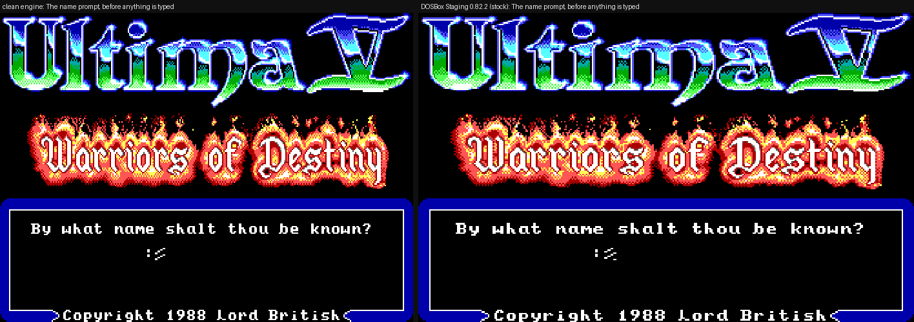
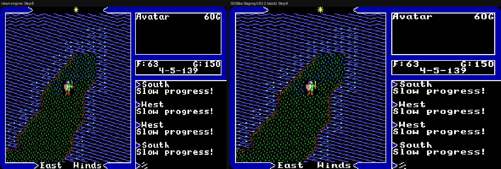
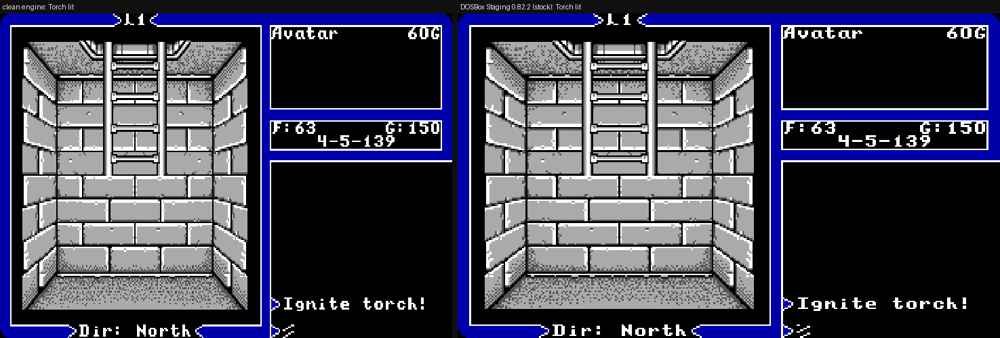
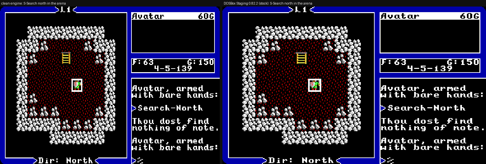
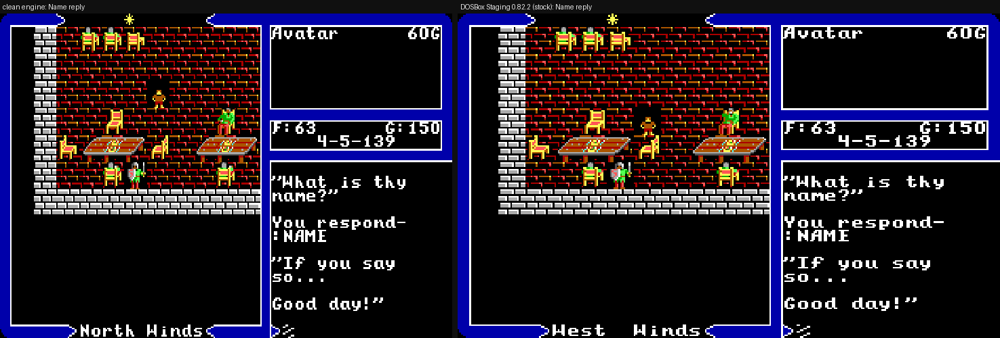
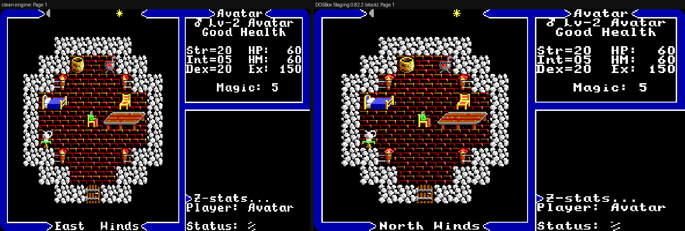

# u5-engine

A clean-room recreation of **Ultima V: Warriors of Destiny** (Origin, 1988) in
Rust, built only from the public specification in
[cleak/u5-spec](https://github.com/cleak/u5-spec). It plays the game from your
own copy of the original data files and is checked frame by frame against the
original DOS game running in DOSBox.

No original game data is included. You need your own copy of Ultima V; the GOG
release works. See [Download](#download) and
[Getting the game files](#getting-the-game-files).

## Side by side

Each image is one moment captured from both programs given the same save and
the same keystrokes: **the engine on the left, the original game in DOSBox on
the right.** They come from the paired test suite described [below](#how-its-verified).

| | |
|---|---|
|  |  |
| Character creation | Overworld travel |
|  |  |
| First-person dungeon | Combat |
|  |  |
| Conversation | Character stats |

Some things legitimately differ from run to run, because the original seeds its
random number generator from the clock: the wind direction, where wandering
NPCs stand, dice rolls and greeting choices. The comparison tooling knows which
differences are random and which are real.

## Status

The game is playable from character creation to the endgame. Implemented
systems:

- the overworld, towns, castles and dungeons;
- combat;
- magic and reagent mixing;
- conversations, shops, inns, healers and guilds;
- quests: the shrines and Codex, the shards and Shadowlords, Blackthorn,
  Stonegate and the Underworld;
- vehicles and weather;
- NPC schedules, time, karma and save/load;
- the intro, character creation and Ultima IV transfer;
- the PC-speaker sound effects.

Current verification (release 1.0):

| Check | Result |
|---|---|
| Unit and integration tests | about 6,250, all passing |
| Scripted route checks (terminal) | 521 of 521 |
| Asset-backed visual tests | 304 of 304 |
| Paired comparisons against DOSBox | 157 of 179 scenarios match on every beat, with zero real differences. The other 22 are 18 scenarios whose outcome the original randomises (dice, greeting pools, NPC traffic) plus 4 measurement probes |
| Closed spec conformance audit | every testable rule in the 88 normative spec files checked: 4,937 rules, with no open blocking gap |
| Exploratory playtests | 25 passes; every confirmed finding is fixed or waiting on a spec answer |

Open work is tracked in this repo's issues. Behaviour the spec doesn't yet pin
down is listed in [u5-spec issues](https://github.com/cleak/u5-spec/issues).
Until the spec owner answers, the engine follows captures of the original.

## Download

Prebuilt packages for each release are on the
[Releases page](https://github.com/cleak/u5-engine/releases):

| System | Package |
|---|---|
| Windows 10/11, 64-bit | `u5-engine-<version>-windows-x86_64.zip` |
| Linux x86_64 (glibc 2.35+: Ubuntu 22.04, Debian 12, Fedora 36 or newer) | `u5-engine-<version>-linux-x86_64.tar.gz` |
| macOS 11+, Apple Silicon and Intel | `u5-engine-<version>-macos-universal.zip` |

`SHA256SUMS` lists the checksum of every package. Each package has a
`RUNNING.txt` with platform notes.

Unpack the package and start the game: on Windows double-click `u5-engine-gui.exe`, on Linux run `u5-engine`, and on macOS open `U5 Engine.app`. With
no arguments the game opens in a window. On first run it looks for your Ultima V
files in the usual install locations, and if it can't find them it asks you to
pick the folder. You can also name the folder on the command line:

```sh
u5-engine --visual-playable /path/to/ultima5   # windowed game
u5-engine --play /path/to/ultima5              # terminal mode, same rules
u5-engine --help                               # every option
```

The engine never writes into your game folder. Your saves live in a per-user
folder: `~/.local/share/u5-engine` on Linux (or under `$XDG_DATA_HOME`),
`%LOCALAPPDATA%\u5-engine` on Windows, and `~/Library/Application Support/u5-engine`
on macOS. Set `U5_ENGINE_RUNTIME_DIR` to put them somewhere else. Run
`u5-engine --setup` to choose a different game folder later.

Controls follow the original: letter keys are the A–Z commands, the arrow keys
or numeric keypad move, Space passes a turn, Ctrl+S toggles sound, and Q saves.

### Linux runtime libraries

The Linux binary links ALSA and udev directly and loads the X11 or Wayland and
Vulkan libraries when it starts. A normal desktop install usually has them all;
if not:

```sh
# Debian / Ubuntu (on 24.04 and later the ALSA package is libasound2t64)
sudo apt install libasound2 libudev1 libx11-6 libxcursor1 libxrandr2 libxi6 \
    libxkbcommon0 libxkbcommon-x11-0 libwayland-client0 libvulkan1 mesa-vulkan-drivers

# Fedora
sudo dnf install alsa-lib systemd-libs libX11 libXcursor libXrandr libXi \
    libxkbcommon libxkbcommon-x11 libwayland-client vulkan-loader mesa-vulkan-drivers
```

You need a graphics driver with Vulkan support. The first-run folder picker
uses your desktop's file-chooser portal (`xdg-desktop-portal` plus its GTK,
GNOME or KDE backend), which GNOME and KDE desktops already include. If you
don't have a portal, pass the game folder on the command line instead.

### macOS and Windows warnings

The macOS app is signed and notarized only when the release was built with the
project's Apple developer certificate. If the zip contains
`MACOS-UNSIGNED.txt`, macOS will block the app until you clear the quarantine
flag; that file explains how. Windows SmartScreen may warn about an
unrecognised app the first time; choose **More info**, then **Run anyway**.

## Getting the game files

This project ships no game data. You need your own copy of
**Ultima V: Warriors of Destiny**.

**Buy it.** The engine is tested against the DOS version sold by
[GOG.com](https://www.gog.com/). GOG has sold Ultima V in the
"Ultima 4+5+6" collection and, at times, as a separate game; check the store
for what is offered now. Any copy of the original DOS PC release should work,
but the GOG one is the verified one.

**Windows.** Install it with the GOG installer or GOG Galaxy. The installer's
default folder is normally `C:\GOG Games\Ultima 5`; GOG Galaxy uses
`C:\Program Files (x86)\GOG Galaxy\Games\Ultima 5` unless you changed its
library folder. The exact folder name can vary between GOG releases. The one
you want contains files such as `BRIT.DAT`, `DATA.OVL` and `ULTIMA.EXE`.

**Linux and macOS.** You don't need Windows or Wine. Download the **Windows**
offline installer from your GOG library (`setup_ultima_5_….exe`, plus any
`.bin` files that come with it, all in one folder) and unpack it with
[innoextract](https://constexpr.org/innoextract/):

```sh
# Install innoextract (1.8 or newer handles current GOG installers)
sudo apt install innoextract        # Debian / Ubuntu
sudo dnf install innoextract        # Fedora
brew install innoextract            # macOS (Homebrew)

# Unpack into a folder of your choice
innoextract --gog --output-dir ~/Games/ultima5 setup_ultima_5_*.exe

# Find the folder that holds the game data
find ~/Games/ultima5 -iname BRIT.DAT
```

Depending on the installer version, the game files land either at the top of
the output folder or in a subfolder such as `app/`. Use the folder that
`find` reports.

**Pointing the engine at the files.** On first run the engine checks common
install locations (including the GOG folders above) and uses the first copy it
finds. If it finds nothing, it opens a folder picker; choose the folder that
contains `BRIT.DAT`. You can always override this by passing the folder on the
command line, as shown under [Download](#download).

## Building from source

For developers. You need a Rust toolchain (stable) and the original game files.
On Linux, install the Bevy build dependencies first:

```sh
sudo apt install pkg-config libasound2-dev libudev-dev libx11-dev libxkbcommon-dev libwayland-dev
```

```sh
# Windowed (Bevy) game. With no game folder it finds your copy (GOG, GOG
# Galaxy, Heroic, Lutris, Wine, Bottles, ...) or opens a setup wizard.
cargo run --release --features visual

# The same with an explicit folder
cargo run --release --features visual -- --visual-playable /path/to/ultima5

# Terminal play loop: same game rules, text rendering
cargo run --release -- --play /path/to/ultima5

# Choose the game folder again (window in visual builds, terminal otherwise)
cargo run --release --features visual -- --setup
```

Without a folder on the command line, the game folder comes from
`U5_GAME_DIR`, then the saved settings (`config.toml` under
`$XDG_CONFIG_HOME/u5-engine`, `%APPDATA%\u5-engine` or
`~/Library/Application Support/u5-engine`), then a search of the usual install
locations, then the wizard. Setup checks every file the engine needs,
identifies the release by SHA-256, and copies the files with their original
upper-case names into a managed folder (`~/.local/share/u5-engine/game-data`,
`%LOCALAPPDATA%\u5-engine\game-data`), so lower-case copies and nested
installer layouts work too.

Release packaging and CI are described in [`docs/releasing.md`](docs/releasing.md).

## How it's verified

The original DOS game is the reference, and the spec is the contract. Four
layers check the engine against them:

1. **Spec conformance.** Rules, message text, timings and tables are read from
   [u5-spec](https://github.com/cleak/u5-spec), and each implemented behaviour
   has a focused test citing its spec section. Periodic audits re-read every
   spec document against the code; the latest is in
   [`docs/audits/`](docs/audits/).
2. **Paired captures.** [`qa/tools/paired_suite.py`](qa/tools/paired_suite.py)
   drives the engine and stock DOSBox from the same save with the same keys and
   screenshots both at each "beat". [`qa/tools/paired_compare.py`](qa/tools/paired_compare.py)
   then compares the message window, stats panel and map view cell by cell. The
   173 scenarios live in [`qa/paired/`](qa/paired/). Each scenario's header says
   what it measures and which differences are known to be random.
3. **Route and frame suites.** Hundreds of scripted routes through the terminal
   and windowed shells, checked against sanitized manifests (state, frame hashes
   and dimensions), with no images committed.
4. **Exploratory playtests.** Headless play sessions across the whole game look
   for crashes, softlocks and divergences from the spec. Each finding is
   independently reproduced before it is fixed.

When the spec is silent or ambiguous, the question goes to the spec owner as an
issue on u5-spec, never to private analysis. Until it is answered, the engine
follows the captured original.

## Clean-room rules

This project is the third stage of a three-stage clean-room effort:

1. **Private analysis** of the original program (not public, never read here).
2. **The public specification** in [cleak/u5-spec](https://github.com/cleak/u5-spec):
   behaviour, data formats and text, written as implementation-agnostic prose.
3. **This engine**, written only from the specification, plus observations of
   the original game running unmodified.

The repository contains no original game files, decoded maps, dialogue dumps,
disassembly or private offsets. The engine reads the user's own data files at
runtime only. The one deliberate exception is the comparison screenshots in
`docs/screenshots/`, which show the original game's graphics for illustration.

## Repository layout

| Path | What's there |
|---|---|
| `crates/u5-runtime` | The game itself: state, rules, parsers for the original data formats, save/load, rendering helpers, and most tests |
| `crates/u5-bevy` | The windowed frontend (feature `visual`): rendering, input, PC-speaker audio |
| `crates/u5-tui` | The terminal frontend and CLI: play loop, scripted runs, route and frame suites |
| `qa/paired/`, `qa/tools/` | Paired DOSBox comparison scenarios and tooling |
| `docs/` | Architecture, commands, sidecars, audits and status |

More documentation:

- [`docs/architecture.md`](docs/architecture.md): crates, data flow and
  clean-room boundaries
- [`docs/commands.md`](docs/commands.md): A–Z command routing by mode
- [`docs/qa-scenarios.md`](docs/qa-scenarios.md): the scenario registry
- [`docs/sidecars.md`](docs/sidecars.md): optional clean-room sidecar files
- [`docs/status-matrix.md`](docs/status-matrix.md): implementation status by system
- [`docs/implementation-notes.md`](docs/implementation-notes.md): the old
  README's detailed notes (historical, not kept current)

## Running the tests

```sh
cargo test --release                                               # unit and integration tests
cargo test --release -p u5-bevy --features original-asset-tests   # needs U5_TEST_ASSET_DIR
cargo run --release -- --route-smoke /path/to/writable/copy        # scripted routes
python3 qa/tools/paired_suite.py <scenario>                        # needs DOSBox Staging and the capture harness
```
